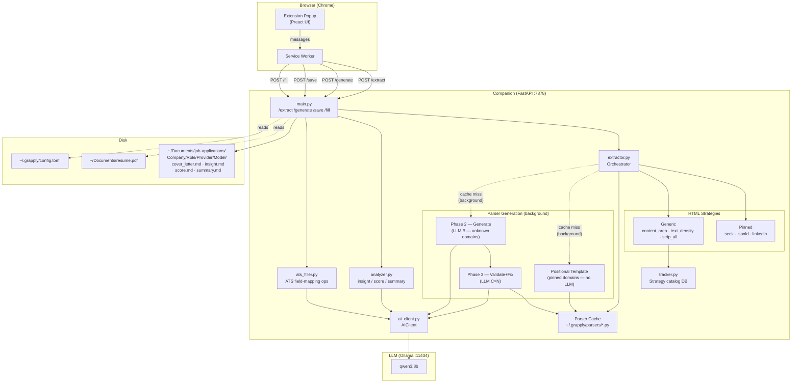
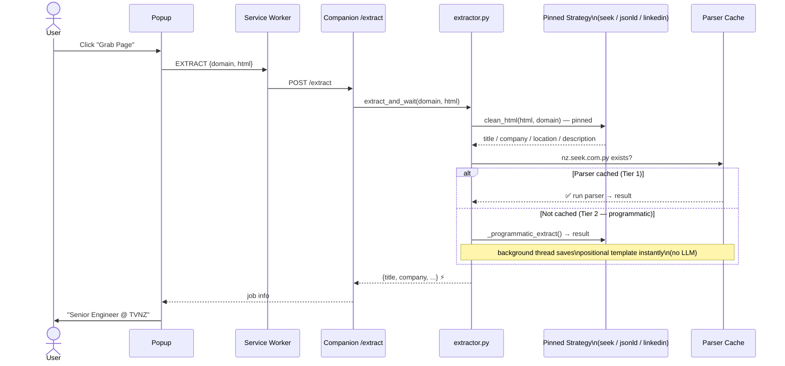
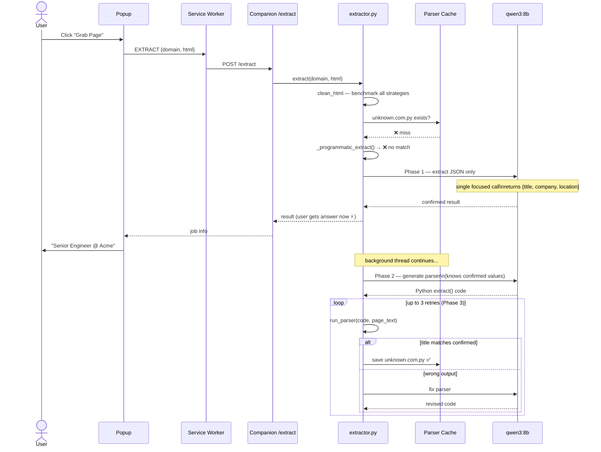
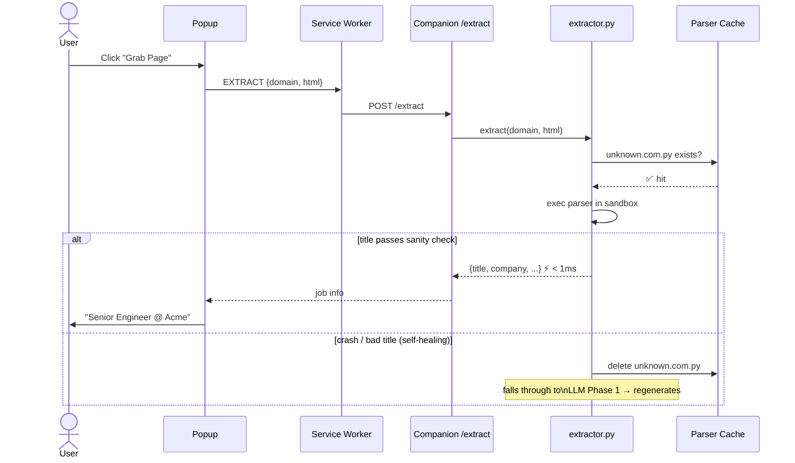

# grapply

> Grab and Apply

[](https://ko-fi.com/grapplyai)

**grapply** is a browser extension + local companion service that reads any job posting, generates a personalized cover letter using your local LLM or online AI provider (Anthropic or OpenAI), and produces a full analysis package — cover letter, job fit score, company summary, and jargon decoder — saved to disk automatically.

<table><tr>
<td></td>
<td></td>
</tr></table>

---

## Features

- **One-click grab** — scrapes any job page; extraction is instant for known sites (SEEK, Indeed, LinkedIn) via structured programmatic strategies, zero LLM
- **Quality-first parsers** — 3-phase pipeline: extract → generate → validate+fix; parsers are cached and re-used; <1ms on repeat visits
- **Pinned strategies** — SEEK, Indeed and LinkedIn always use their native structured data (inline JSON / JSON-LD / title tag), not fragile CSS selectors
- **Self-healing** — stale or broken parsers are auto-detected and regenerated
- **AI cover letter** — personalized to your resume and the specific role
- **Writing style tuner** — optional rules that adjust tone, sentence variety, and vocabulary to match your natural voice; local LLM only, toggle in settings
- **Post-save analysis** — `insight.md` (jargon decoder), `score.md` (fit score), `summary.md` (company profile)
- **ATS form filler** — detects application forms, generates field-mapping ops once per site, then fills instantly
- **Local-first AI** — defaults to [Ollama](https://ollama.com); OpenAI and Claude supported
- **Privacy by design** — resume stays on disk; only job text reaches the AI
- **Settings page** — web UI at `http://localhost:7878/settings` for provider, model, prompts, and toggles
- **Auth token** — optional `X-Grapply-Token` header protects all endpoints
- **MCP server** — exposes parser tools and application tracker to Claude Desktop, Cursor, or any MCP client
- **Feng shui panel** — fun optional feature: daily lucky day and best interview dates 🈴
- **Usage stats dashboard** — live cost and token tracking per provider/model/endpoint, accessible at `http://localhost:7878/stats`

---

## Quick Start

### 1 — Configure `~/.grapply/config.toml`

```toml
output_dir     = "~/Documents/job-applications"
companion_port = 7878
auth_token     = ""          # optional — protects all API endpoints

[ai]
provider = "ollama"
endpoint = "http://localhost:11434"
model    = "qwen3:8b"
timeout      = 180
tool_timeout = 600

[resume]
path = "~/Documents/my-resume.pdf"   # PDF, MD or TXT

[cover_letter]
max_words  = 450
language   = "English"
humanize   = false    # writing style tuner (local LLM only)
```

### 2 — Start companion

```bash
cd grapply/companion
pip install -r requirements.txt
./start.sh          # kills nothing if already running; starts fresh otherwise
# or manually:
#   python -m uvicorn main:app --host 127.0.0.1 --port 7878
```

### 3 — Load the extension

1. Open `chrome://extensions`
2. Enable **Developer mode**
3. Click **Load unpacked** → select the `extension/` folder
4. Pin the grapply icon to your toolbar

---

## How It Works

### Fresh job discovery

Open `http://localhost:7878/discovery`, or use **Explore** in the extension.
Discovery only reads and ranks; it never submits an application.

- New configurations search Berlin first in preference, with Hamburg, Frankfurt
  am Main and Munich also eligible, plus a separate Germany-remote phase.
  Mandatory office attendance elsewhere is not treated as Germany-remote.
- C++/.NET/Python matches retain their language scores. Genuinely
  language-agnostic software and AI engineering roles can also qualify.
  An explicit different specialist stack is not relabelled as agnostic.
- The default window is seven days, requiring an employer's original
  publication date. Greenhouse `updated_at` is an edit date, not a posting date.
  Ashby `publishedAt` is **last** published, and its `isRemote` can include
  hybrid jobs; discovery preserves these distinctions.
- Unknown dates, board-only dates, last-publication dates and contradictory
  office requirements appear under **Needs verification**, not the shortlist.
  Known old vacancies are excluded. Uncertain jobs do not consume the AI budget.
- Existing saved phases and age settings are **not automatically migrated**.
  Use **Germany preferred cities · 7 days** for a one-off expanded scan. The
  stack-agnostic checkbox is persisted with **Save search preferences**.
  StepStone is not part of these discovery sources; no access-control bypasses.

```bash
# Four approved cities, strict seven-day scan, without LLM calls
python -m companion.discovery --market german-cities --since-days 7 --prefilter-only

# Inspect a supported employer URL without saving config or running a scan
python -m companion.discovery --check-url https://job-boards.greenhouse.io/fender/jobs/8288981

# Deliberate exception: broaden to unverified/undated results
python -m companion.discovery --market berlin --since-days 7 --allow-unverified --prefilter-only
```

Evidence links and publication types are shown in results. Freshness and stack
matching are explainable heuristics, not guarantees of employer eligibility or
fit. The review queue can be larger than the strict shortlist when sources do
not expose an original publication date.

Source semantics: [Greenhouse Job Board API](https://docs.greenhouse.io/job-board.html)
and [Ashby public job posting API](https://developers.ashbyhq.com/docs/public-job-posting-api).

1. Navigate to any job posting
2. Click the grapply icon → **Grab Page**
3. Companion extracts job info (instant for SEEK / Indeed / LinkedIn; ~3–10 min LLM call on first visit to an unknown site)
4. Click **Generate Cover Letter** — companion reads your resume from disk and calls the AI
5. Cover letter is saved; analysis files are written in the background

---

## Extraction Strategy

Extraction is tiered — LLM is only used when nothing else works:

| Tier | Trigger | Speed | LLM? |
|------|---------|-------|------|
| **1 — Cached parser** | Parser file exists for domain | < 1 ms | ❌ |
| **2 — Programmatic** | SEEK / Indeed / LinkedIn (pinned domains) | < 5 ms | ❌ |
| **3 — LLM Phase 1** | Unknown domain, first visit | ~3–10 min | ✅ once |

After Tier 2 or 3, a parser is saved in the background so the **next visit is always Tier 1**.

---

## Parser Generation (Background, Quality-First)

For **pinned domains** (SEEK, Indeed, LinkedIn), `clean_html` always uses the site's native structured extractor, producing a stable 4-line format (`title / company / location / description`). A deterministic positional template is saved immediately — no LLM needed.

For **unknown domains**, the 3-phase pipeline runs in the background after extraction returns to the user:

```
Phase 1 — Extract (LLM A)   focused JSON-only call → confirmed {title, company, location}
Phase 2 — Generate (LLM B)  writes Python parser using confirmed values as ground truth
Phase 3 — Validate+Fix      runs parser → compares → asks LLM to fix (up to 3 retries)
```

---

## Self-Healing Parsers

The parser cache validates every result before trusting it:

| Situation | What happens |
|-----------|-------------|
| Parser raises an exception | Logged ⚠️, deleted, pipeline regenerates |
| Parser returns empty title | Logged ⚠️, deleted, pipeline regenerates |
| Title too short (< 5 chars) | Logged ⚠️, deleted, pipeline regenerates |
| Title matches domain name (`"SEEK"`, `"LinkedIn"`) | Logged ⚠️, deleted, pipeline regenerates |
| Title too long or contains newlines | Logged ⚠️, deleted, pipeline regenerates |
| Title looks legitimate | ✅ `[cache] hit — title='Senior Engineer'` |

---

## Architecture



---

## Sequence: Pinned domain (SEEK / Indeed / LinkedIn)



---

## Sequence: Unknown domain — first visit



---

## Sequence: Repeat visit (parser cached)



---

## LLM Usage Summary

| Task | LLM calls | Frequency |
|------|-----------|-----------|
| Extraction — pinned domain (SEEK/Indeed/LinkedIn) | 0 | Never |
| Extraction — unknown domain, first visit | 1 (Phase 1) | Once per domain |
| Parser generation — pinned domain | 0 | Never |
| Parser generation — unknown domain | 2–5 (Phase 2 + Phase 3 retries) | Once per domain |
| Cover letter | 1 | Every application |
| Analysis (insight / score / summary) | 3 | Every application |
| ATS filler generation | 1–3 | Once per ATS domain |
| ATS filler use (cached) | 0 | Every subsequent fill |

---

## AI Providers

| Provider | Config | Notes |
|----------|--------|-------|
| **Ollama** (default) | `endpoint: http://localhost:11434` | Free, private, local |
| **llama.cpp** | `endpoint: http://localhost:8080` | OpenAI-compatible API |
| **OpenAI** | `provider: openai` + `api_key` | GPT-4o recommended |
| **Anthropic** | `provider: claude` + `api_key` | claude-3-5-sonnet recommended |

---

## Usage Stats Dashboard

The companion serves a live cost and token tracking dashboard at `http://localhost:7878/stats`. Click **Show Usage Stats** at the bottom of the extension popup to open it.

The dashboard shows:

- **Summary cards** — total calls, tokens, estimated cost, avg cost per cover letter
- **Daily cost chart** — token spend over time with call volume overlay
- **Endpoint breakdown** — donut chart of generate / extract / analyze calls
- **Model cost bar** — cost comparison across providers and models
- **Insights panel** — best value model, avg cost per cover letter, cache efficiency
- **Breakdown table** — per provider/model/endpoint with avg cost per call

Time filters: Today / 7 days / 30 days / All time. Auto-refreshes every 30 seconds.

---

## Settings Page

Navigate to `http://localhost:7878/settings` for a web UI that configures:

- **AI provider** — toggle Online (OpenAI / Claude) vs Offline (Ollama / llama.cpp)
- **Model selection** — presets or custom model name
- **Endpoint and API key**
- **Resume path**
- **Cover letter settings** — max words, language, system/user instructions
- **Writing style tuner toggle** — adjusts tone and vocabulary to match your natural voice (local LLM only)
- **Easter egg toggle** — fun optional feature for HTML output

All changes are saved to `~/.grapply/config.toml` and take effect immediately.

---

## Writing Style Tuner

When `humanize = true` in config (or toggled via the settings checkbox), the companion appends structural and vocabulary rules to the cover letter system prompt to better match your natural writing voice.

**How it works:**
- Sentence length variation for a more natural reading rhythm
- Discourse markers that reflect conversational tone
- Casual connectors and contractions where appropriate
- Banned word list (robust, scalable, seamless, leverage, etc.) to avoid generic AI phrasing

Only activates when the AI provider is `ollama` or `llamacpp` (local). Cloud providers (OpenAI, Claude) are not affected.

---

## MCP Server

The companion includes a proper MCP (Model Context Protocol) server for integration with Claude Desktop, Cursor, or any MCP client:

```bash
python companion/mcp_server.py   # stdio transport
```

**Exposed tools:**
- `run_parser` — test a Python extract() function against page text
- `save_parser` — cache a working parser for a domain
- `read_parser` / `list_parsers` / `delete_parser` — manage parser cache
- Application tracker tools (query saved jobs, stats)

Add to Claude Desktop's `claude_desktop_config.json`:
```json
{
  "mcpServers": {
    "grapply": {
      "command": "python",
      "args": ["/path/to/grapply/companion/mcp_server.py"]
    }
  }
}
```

---

## Output Files

After each application, the companion writes to `~/Documents/job-applications/<Company>/<Role>/<provider>/<model>/`:


| File | Contents |
|------|----------|
| `cover_letter.md` | Generated cover letter (Markdown) |
| `cover_letter.html` | Same, rendered as HTML |
| `insight.md` | Jargon decoder — red flags, culture signals |
| `score.md` | Job fit score against your resume |
| `summary.md` | Company profile fetched from their website |


Example of insight.md:

--- 
# Role Insights — Embedded Software Engineer at XXX

**Verdict:** Apply with caution ⚠️  **Generated:** 2026-05-16

> A stable, well-compensated role at a genuinely reputable medical device company, but you'll essentially be a solo embedded software owner inheriting underdocumented legacy code with heavy regulatory compliance obligations that the job listing quietly glosses over.

## 🚩 Red Flags

| Phrase | What it really means |
|--------|---------------------|
| Collaborating with original developers to build a deep understanding of existing embedded software architectures | The original developers may no longer be there, documentation is likely sparse or outdated, and you'll be inheriting legacy code that nobody fully understands anymore. |
| small, multidisciplinary team | You will be the only embedded software person, expected to make all software decisions alone while also interfacing with clinical, mechanical, and electrical people who don't speak your language. |
| extending and enhancing them with new capabilities and algorithms | Medical device software is heavily regulated (IEC 62304, FDA/TGA submissions); adding features to certified devices means significant documentation, validation, and regulatory burden on top of the actual engineering work. |
| clinical trial readiness | Your software will need to meet stringent regulatory standards with extensive traceability and testing documentation — this is not a typical embedded role and the compliance overhead is substantial. |

## ✅ Green Flags

| Phrase | What it signals |
|--------|----------------|
| Bi-annual Profit share | Profit sharing twice a year is genuinely above-average compensation structure and signals the company is financially healthy and willing to share gains with employees. |
| High rates of internal promotion | If true, this suggests genuine career progression without needing to job-hop, which is rare and valuable in engineering roles. |
| Annual Salary Review | Explicitly committing to annual reviews is a positive sign they won't let your salary stagnate quietly. |
| world leader in the design, manufacture, and marketing of medical devices, exporting to over 120 countries | Fisher & Paykel Healthcare is a legitimate, well-established company with real products — this is not a startup with vaporware; your work will actually reach patients. |
| Employee share purchase scheme | Ownership stake in a publicly traded, profitable medical device company is a tangible financial benefit worth real money over time. |

---
*Generated by grapply*

---

Example of score.md:

# Job Fit — Embedded Software Engineer at XXX

## Score: 7/10 — Apply with caveats ⚠️

**Experience gap:** minor  **Overqualified risk:** No  **Generated:** 2026-05-16

## ✅ Matching Skills
- Embedded software/firmware development (20 years experience)
- Embedded systems architecture and design
- Working with mature hardware platforms (Buildroot Linux, Oclea SDK)
- Cross-functional team collaboration
- Technical leadership and mentoring
- CI/CD pipeline development
- C/C++ embedded development (implied through Buildroot/control systems work)
- Sensor systems experience
- Prototyping and testing
- Communication and documentation skills
- New Zealand-based (Auckland)

## ❌ Missing Skills
- Medical device development experience
- Regulatory/clinical trial software development (IEC 62304 or similar)
- Algorithm development for embedded systems (explicitly stated)
- Experience analysing existing undocumented embedded architectures
- Safety-critical or healthcare-specific software standards
- Firmware-level hardware bring-up experience (not clearly evidenced)

## Honest Assessment
With 20 years of embedded systems experience including Buildroot Linux, control systems integration, and cross-functional technical leadership, this candidate brings substantial depth that directly aligns with the core role requirements. The work at Framecad on machine control systems and embedded-to-cloud interfaces is particularly transferable to extending existing embedded architectures. The main caveat is no explicit medical device or clinical/regulatory experience, but the candidate's strong engineering judgement, embedded maturity, and Auckland location make them a genuinely competitive applicant who should absolutely apply.

---
*Generated by grapply*

---

## Security

- **Auth token** — set `auth_token` in config.toml; all API endpoints require `X-Grapply-Token` header when set
- **XSS protection** — Markdown rendering in the extension strips all raw HTML via `marked.js` renderer override
- **Input sanitization** — ATS fill data keys/values are truncated to prevent injection
- **Job ID hashing** — uses blake2b (not MD5) for filesystem-safe job identifiers
- **Thread safety** — per-domain locks prevent duplicate parser generation; config reload is atomic

---

## Requirements

- Python 3.10+
- Chrome 109+
- Ollama or an OpenAI/Claude API key

---

## License

MIT — see [LICENSE](LICENSE)


